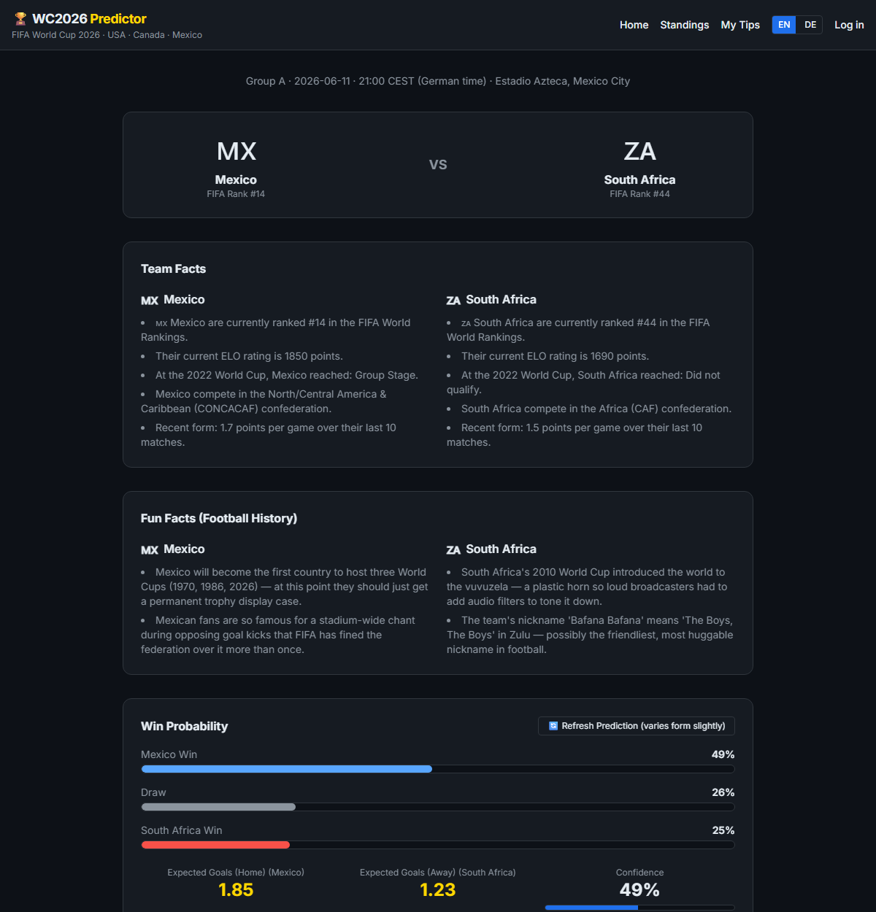
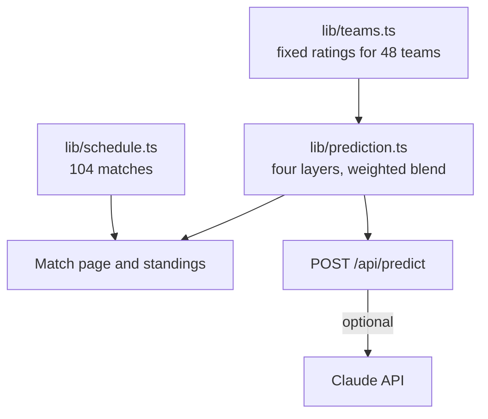

# WC2026 Predictor

[](https://github.com/Hakimi404/wc2026-predictor/actions/workflows/ci.yml)

**Match predictions for the 2026 FIFA World Cup, from a weighted blend of four statistical layers.**



## Overview

A single rating can hide what drives a prediction. This dashboard combines four simple layers and shows each one next to the blended result. It covers the 104-match schedule and 48 teams, and it was built before the tournament started. The team ratings are fixed values, so it makes no use of real results.

## Features

- **Match predictions:** win, draw and loss probabilities, expected goals, the five most likely scorelines and a 7×7 score heatmap.
- **Layer breakdown:** a table showing what each layer predicts on its own.
- **Group standings:** tables for all 12 groups, projected by playing each match at its rounded expected goals.
- **Schedule:** all 104 matches, filterable by date, group and stage.
- **Ask Claude:** an optional written analysis based on the model's numbers. Without an API key it returns a short statistical summary.
- **English and German interface.**

## Tech stack

Next.js 16 (App Router), React 19, TypeScript, Tailwind CSS, Anthropic SDK.

## Architecture



| Layer | Weight | How it works |
| --- | --- | --- |
| Dixon-Coles Poisson | 45% | Builds a score matrix from each team's attack and defence rates, with a low-score correction (rho = -0.13) |
| ELO | 35% | Converts the rating difference to win and loss chances, with a fixed 22% draw rate |
| Recent form | 12% | Shifts the odds by the difference in points per game |
| Head-to-head | 8% | Adds a hand-set bonus for five specific matchups |

Only the Dixon-Coles layer produces scorelines and expected goals. The blend applies to the win, draw and loss probabilities.

## Getting started

**Prerequisites:** Node.js 22 and npm. An Anthropic API key is optional.

```bash
npm install
cp .env.example .env.local   # optional: add ANTHROPIC_API_KEY for Ask Claude
npm run dev
```

Open http://localhost:3000.

## Testing

There are no automated tests yet. CI runs on every push and pull request:

```bash
npm run lint
npm run build   # also type-checks the project
```

## Status

Finished. It was built for the 2026 tournament and isn't updated with results.

Known limitations:

- **Ratings:** attack, defence, ELO and form values are fixed inputs in `lib/teams.ts`. They aren't fitted or updated by the code, and no accuracy has been measured.
- **Refresh button:** it adds a small random change to the form values. It isn't a simulation.
- **Accounts:** `/account` stores unsalted SHA-256 password hashes in the browser's localStorage. It's a local demo, not real authentication.
- **My Tips:** picks are saved in the browser, but they are never scored. The date is hard-coded to the opening day, and the comparison uses the model rather than real results.
- **Ask Claude:** the route has no rate limiting and uses a fixed model ID that may need updating.

Possible next steps: fit the ratings from historical results, backtest against the 2026 tournament and add unit tests for the layers.

## Technical challenges

- **Keeping probabilities valid:** the Dixon-Coles correction changes the score matrix, so it's normalised afterwards. The blended result is clipped and normalised again.
- **Browser-only state:** language, session and saved picks live in localStorage, so they're loaded after hydration to keep the server and client render in sync.

## License

[MIT](LICENSE)
